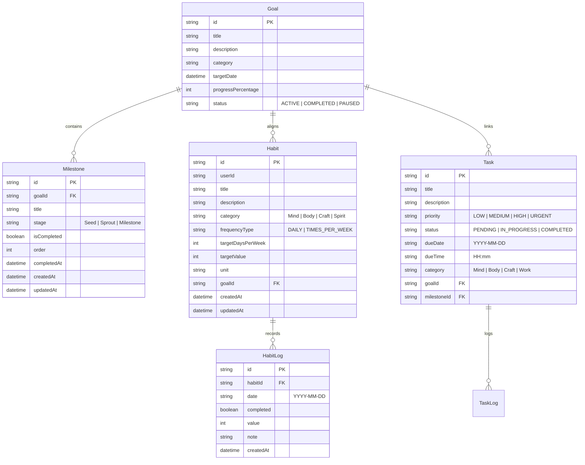

# 03. Technical Architecture & Data Model

Parent: [[00_Index]] | Previous: [[02_Design_System]] | Next: [[04_Features_and_Workflows]]

---

## 🛠️ Technology Stack

| Layer | Technology | Rationale |
| :--- | :--- | :--- |
| **Framework** | **Next.js 16 (App Router)** | Modern server/client rendering, server actions, route handlers, optimized font loading |
| **Frontend** | **React 19 & TypeScript** | Strict type safety, modern hooks, declarative state handling |
| **Styling** | **Tailwind CSS v4** | Rapid utility styling with bespoke color themes matching `design_concept_6` |
| **Database** | **SQLite (via Prisma ORM)** | Zero-config, fast, 100% local, no external server or API keys required, easily backupable file |
| **Icons** | **lucide-react** | Clean, lightweight botanical and productivity iconography |

---

## 📁 Application Directory Structure

```
Personal-Project/
├── notes/                   # Obsidian-compatible documentation vault
│   ├── 00_Index.md
│   ├── 01_Project_Overview.md
│   ├── 02_Design_System.md
│   ├── 03_Architecture_and_Data_Model.md
│   ├── 04_Features_and_Workflows.md
│   └── 05_Implementation_Log.md
├── prisma/
│   ├── schema.prisma        # Database schema definitions
│   └── seed.ts              # Initial sample data matching design_concept_6
├── public/                  # Static assets & illustrations
├── src/
│   ├── app/                 # Next.js App Router
│   │   ├── layout.tsx       # Root layout with fonts & global theme
│   │   ├── page.tsx         # Dashboard / Journal (design_concept_6 main screen)
│   │   ├── tasks/page.tsx   # Detailed To-Do list manager
│   │   ├── habits/page.tsx  # Habit tracking & streak management
│   │   ├── seasons/page.tsx # Calendar history & retrospective drill-down
│   │   ├── milestones/page.tsx # Goals and milestone progress trees
│   │   ├── growth/page.tsx  # Analytics, heatmaps, and consistency patterns
│   │   └── api/             # RESTful API route handlers
│   ├── components/          # Reusable UI components
│   │   ├── layout/          # Sidebar, HeaderCapsules, MainContainer
│   │   ├── dashboard/       # DailyIntentionsCard, HabitGrowthGrid, LongTermVisionCard, WeeklyFlowCard
│   │   ├── tasks/           # TaskItem, TaskFormModal, TaskFilters
│   │   ├── habits/          # HabitCard, HabitDotMatrix, StreakBadge
│   │   └── ui/              # Badges, Buttons, Modal, ProgressBars, Dropdowns
│   ├── lib/
│   │   ├── prisma.ts        # Singleton Prisma client instance
│   │   └── utils.ts         # Date formatting, streak calculation math, helpers
│   └── types/               # TypeScript interface definitions
├── package.json
└── tailwind.config.ts
```

---

## 🗄️ Relational Database Schema (Prisma)



---

## ⚡ Data Flow & Persistence Strategy

1. **Local SQLite File**: Stored directly in `prisma/dev.db`.
2. **Server Actions & API Routes**: Next.js Server Actions allow instant mutation (e.g. clicking a habit or task checkmark) with automatic optimistic UI updates and instant cache revalidation.
3. **Streak Engine Algorithm**:
   - Calculates consecutive completed days backwards from current date.
   - Preserves historical best streak.
   - Generates weekly consistency percentages ($(\text{completed} / \text{expected}) \times 100$).
