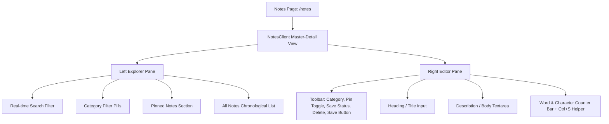

# 08. Field Notes System (`/notes`)

Parent: [[00_Index]] | Previous: [[07_Sleep_Tracking_and_Rest_Rhythm]]

---

## 🌿 Overview & Purpose
The **Field Notes** system (`/notes`) provides users with a distraction-free, mindful digital canvas to capture thoughts, ideas, meeting notes, reflections, and personal insights. 

It functions as the user's personal thought sanctuary, tightly integrated into Rooted's editorial serif aesthetic (`Fraunces`, warm linen `#F7F4EB`, deep forest green `#1E3127`, and soft botanical badges).

---

## 🏛️ Data Architecture (`prisma/schema.prisma`)

```prisma
model Note {
  id        String   @id @default(cuid())
  title     String   @default("Untitled Note") // Heading of the note
  content   String   @default("")              // Description / body
  category  String   @default("General")       // Mind, Body, Craft, Spirit, Study, Career, General
  isPinned  Boolean  @default(false)           // Pinned notes stay at top of explorer
  color     String?                            // Optional accent color
  createdAt DateTime @default(now())
  updatedAt DateTime @updatedAt
}
```

---

## ⚡ Server Actions (`src/lib/actions.ts`)

1. **`getNotes()`**: Fetches all notes ordered by `isPinned: "desc"` then `updatedAt: "desc"`.
2. **`createNote(data)`**: Creates a new note record with provided heading, description, and category.
3. **`updateNote(id, data)`**: Persists title/heading, content/description, category, and pin status.
4. **`deleteNote(id)`**: Removes a note record with database cascade safety.
5. **`togglePinNote(id)`**: Toggles the pinned boolean flag for quick access at the top of the list.

All mutating actions invoke `revalidatePath("/notes")` to ensure instant data freshness across client renders.

---

## 🎨 User Interface & Components (`NotesClient.tsx`)

The `/notes` page is constructed using a **Master-Detail Dual-Pane Architecture**:



### Key Interactive Features:
- **Instant Heading & Description Editing**: Clean, large editorial serif heading input and spacious description textarea.
- **Dedicated "Save Note" Button**: Provides tactile button interaction and feedback (`Saved` checkmark indicator).
- **Keyboard Shortcut**: `Ctrl+S` / `Cmd+S` triggers instant manual save.
- **Sidebar Integration**: Linked directly in the main `Sidebar.tsx` navigation bar with the `NotebookPen` icon.
- **Responsive Mobile Switcher**: Toggles smoothly between note explorer list and note editor on smaller devices.
