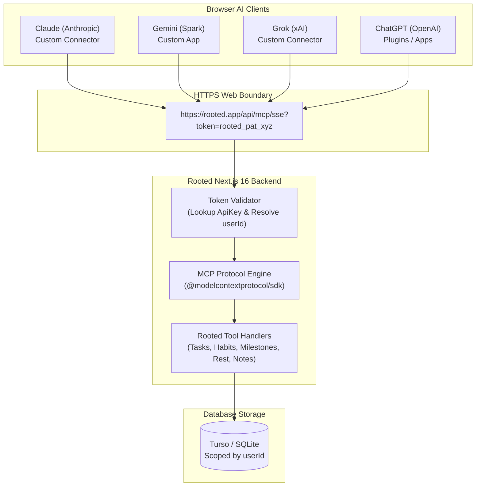

# 🤖 Rooted — AI Connectors & Remote Model Context Protocol (MCP)

This document provides a comprehensive technical blueprint and implementation guide for connecting **Rooted** to major AI conversational assistants (**Gemini, Claude, Grok, and ChatGPT**) in the browser using the open **Remote Model Context Protocol (MCP)** standard.

---

## 1. Executive Summary & The Universal Protocol

Modern browser-based AI assistants have converged on a single universal standard for connecting to third-party web apps: **Remote MCP (Model Context Protocol)** running over **HTTPS / Server-Sent Events (SSE)**.

Instead of writing four disparate, incompatible plugins:
- **Gemini (Spark)** requests: `https://your-domain.com/mcp`
- **Grok (xAI)** requests: `https://mcp.example.com/sse`
- **Claude (Anthropic)** requests: `https://mcp.example.com/mcp`
- **ChatGPT (OpenAI)** accepts: `Remote MCP & Custom App connectors`

A single unified **Remote MCP server** built into Rooted's Next.js backend will instantly power all four AI platforms simultaneously.



---

## 2. Architecture & Data Flow

### The MCP Request Lifecycle
1. **Connection Handshake**:
   - The AI client (e.g. Claude or Grok) makes an HTTP GET request to `https://rooted.app/api/mcp/sse?token=rooted_pat_...`.
   - Rooted validates the token, extracts the user's `userId`, establishes an open Server-Sent Events (SSE) stream, and returns a unique session ID.
2. **Tool Discovery (`tools/list`)**:
   - The AI asks: *"What capabilities does this application offer?"*
   - Rooted returns the machine-readable list of available tools (e.g., `get_today_sanctuary`, `list_intentions`, `log_habit`, `create_intention`).
3. **Tool Invocation (`tools/call`)**:
   - When the user types: *"I finished my 30-minute reading session, log it in Rooted"*, the AI recognizes the intent and sends a JSON-RPC POST request:
     ```json
     {
       "method": "tools/call",
       "params": {
         "name": "log_habit",
         "arguments": {
           "habitName": "Reading",
           "note": "Completed 30 minutes in evening"
         }
       }
     }
     ```
4. **Execution & Scoped Mutation**:
   - Rooted resolves the habit belonging to that `userId`, commits the completion log to SQLite, recalculates the streak and Harmony score, and returns the updated status.
5. **Conversational Feedback**:
   - The AI crafts a warm, mindful message to the user:
     > *"Logged! You're now on a 7-day streak for Reading. Your daily Harmony Score is 88%."*

---

## 3. Phase-by-Phase Implementation Blueprint

### Phase 1: Database Model & User Token Security
To guarantee absolute privacy and multi-tenant data isolation (see [[09_Authentication_and_Multi_Tenancy]]), each external AI connection must authenticate using a **Personal Access Token (PAT)** tied directly to the user's `userId`.

#### Prisma Schema Update (`prisma/schema.prisma`):
```prisma
model ApiKey {
  id          String    @id @default(cuid())
  name        String    @default("AI Connector")
  keyHash     String    @unique
  keyPrefix   String    // e.g. "rooted_pat_abc12..." for UI identification
  userId      String    // Clerk User ID ownership
  lastUsedAt  DateTime?
  expiresAt   DateTime?
  createdAt   DateTime  @default(now())
  updatedAt   DateTime  @updatedAt

  @@index([userId])
}
```

#### Token Security Rules:
- **Hashing**: Tokens are generated with cryptographically secure random bytes (`crypto.randomBytes(32)`). Only the SHA-256 hash is stored in the database.
- **Prefix**: Tokens carry the recognizable prefix `rooted_pat_...`.
- **Relational Integrity**: Every database query triggered via MCP forces a `where: { userId }` constraint. The AI is physically incapable of querying or altering another user's records.

---

### Phase 2: Remote MCP Protocol Engine (`/api/mcp`)
We leverage the official `@modelcontextprotocol/sdk` to build the Next.js server endpoints.

#### Route Structure in Next.js App Router:
- **`src/app/api/mcp/sse/route.ts`**: Handles incoming SSE streams (GET requests). Authenticates the token via query param `?token=` or `Authorization: Bearer`.
- **`src/app/api/mcp/messages/route.ts`**: Handles JSON-RPC POST requests containing tool executions and client messages.
- **Middleware Whitelist (`src/middleware.ts`)**:
  - `/api/mcp(.*)` must be added to `isPublicRoute` in Clerk middleware so that automated cloud connections from Anthropic, Google, and xAI are not redirected to the `/sign-in` HTML page.

---

### Phase 3: The 8 Core Rooted Tools
The MCP server exposes 8 tailored tools that cover all daily workflows described in [[04_Features_and_Workflows]]:

| # | Tool Identifier | Parameters | Functionality |
| :--- | :--- | :--- | :--- |
| **1** | `get_today_sanctuary` | None | Returns today's full summary: current date, Harmony score (0–100%), active habits completion status, today's intentions, and rest hours. |
| **2** | `list_intentions` | `horizon?: "TODAY" \| "UPCOMING" \| "ANYTIME"`, `status?: "PENDING" \| "COMPLETED"` | Lists user tasks with category, priority, and due dates. |
| **3** | `create_intention` | `title: string`, `category?: string`, `priority?: string`, `dueDate?: string` | Plants a new intention in Today, Upcoming, or Anytime. |
| **4** | `complete_intention` | `taskId: string` | Marks an intention as completed in the focus dial. |
| **5** | `reschedule_overdue_tasks` | `targetDate?: string` | Triggers the Morning Reset, shifting all overdue pending tasks to today with one instruction. |
| **6** | `list_habits` | `status?: "ACTIVE" \| "COMPLETED"` | Retrieves habit list, streak counts, frequencies, and today's checked status. |
| **7** | `log_habit` | `habitId?: string`, `habitName?: string`, `note?: string` | Logs a habit completion for today, recalculates streak, and returns new Harmony score. |
| **8** | `add_note` | `title: string`, `content: string`, `category?: string`, `isPinned?: boolean` | Captures reflections, thoughts, or ideas directly into the Field Notes thought garden. |

---

### Phase 4: Settings UI ("AI Connectors & Keys")
Inside `src/app/settings/SettingsClient.tsx`:
- A clean, tranquil card titled **"AI Assistant Connectors (MCP)"**.
- **Generate Connector URL**: Generates a token and formats the exact HTTPS connection URL.
- **Platform-Specific 1-Click Copy Buttons**:
  - **Gemini Spark**: Formatted for `https://your-domain.com/api/mcp/sse?token=...`
  - **Claude**: Provides Connector Name ("Rooted") + MCP Server URL.
  - **Grok**: Formatted with Name ("Rooted") + Server URL.
  - **ChatGPT**: Formatted for custom plugin/app setup.
- **Revoke Access**: Allows the user to revoke a token at any moment, instantly disabling AI access.

---

### Phase 5: Local Testing vs Production Tunneling

#### The Localhost Challenge:
When running on `http://localhost:3000`, browser AIs (Claude.ai, Gemini, Grok) run in Google/Anthropic/xAI cloud data centers. They cannot reach your private computer's `localhost` without an encrypted tunnel.

#### The Development Bridge (Cloudflare Tunnel / ngrok):
For local pair testing:
1. Run local dev server: `npm run dev` (Port 3000).
2. Start a secure public HTTPS tunnel:
   ```bash
   npx cloudflared tunnel --url http://localhost:3000
   ```
3. Cloudflare outputs a public address: `https://rooted-preview.trycloudflare.com`.
4. Your MCP server URL becomes:
   `https://rooted-preview.trycloudflare.com/api/mcp/sse?token=rooted_pat_...`
5. Paste this URL into Claude or Gemini Spark for immediate interactive testing.

#### Production Deployment:
Once Rooted is deployed to production (e.g. Vercel), your permanent custom domain (`https://rooted.app/api/mcp/sse?token=...`) works 24/7 without needing tunnels.

---

### Phase 6: How Each Platform Connects

#### 1. Gemini (Spark):
##### To Integrate Rooted to Gemini:
1. Open **Gemini in the browser** (`https://gemini.google.com`).
2. Navigate: **Settings (⚙)** $\rightarrow$ **Personal Intelligence** $\rightarrow$ **Connected Apps** $\rightarrow$ **Add Custom Apps** (or *Add a custom app*).
3. Paste the key URL into the **MCP Server URL** field:
   `https://<tunnel-or-domain>/api/mcp?token=rooted_pat_...`
4. Leave **Client ID** and **Client secret** completely empty (Rooted authenticates directly via URL token). Name the server `Rooted Sanctuary MCP Server` and click **Next** and **Connect** (or **Save**).

##### To Use on Gemini:
1. Switch to the **Spark tab** in the left sidebar of Gemini (custom MCP apps run exclusively in Spark).
2. Type `@` in the prompt input and select **Rooted Sanctuary MCP Server**.
3. On the first prompt, click **Allow** when prompted: *"Let Gemini use [action] from Rooted Sanctuary MCP Server"*.
4. Conversational queries will now execute live MCP tools against your sanctuary (e.g. `get_today_sanctuary`, `reschedule_overdue_tasks`, `create_intention`, `log_habit`).

#### 2. Claude (Anthropic):
##### To Integrate Rooted to Claude:
1. Open **Claude in the browser** (`https://claude.ai`) or Claude Desktop.
2. Go to **Settings (⚙) $\rightarrow$ Connectors** $\rightarrow$ Click **Add custom connector**.
3. Fill in the connector fields:
   - **Name**: `Rooted`
   - **MCP Server URL**: `https://<active-tunnel-or-domain>/api/mcp?token=rooted_pat_...`
     *(Note: Use `/api/mcp` without `/sse` to use modern Streamable HTTP and avoid SSE deprecation warnings)*.
4. Click **Continue** (or *Continue anyway* if prompted for manual configuration, selecting **HTTP** transport).

##### To Use on Claude:
- Claude automatically activates the connector across conversations.
- Ask questions naturally: *"Check my Rooted Sanctuary status"*, *"What habits do I have pending today?"*, or *"Log my reading habit for today"*.

#### 3. Grok (xAI):
##### To Integrate Rooted to Grok:
1. Open **Grok in the browser** (`https://grok.com` or via X).
2. Click on **Plugins** $\rightarrow$ **New Connector** $\rightarrow$ **Custom** $\rightarrow$ **Add Connector**.
3. Fill in the connector fields:
   - **Name**: `Rooted`
   - **MCP Server URL**: `https://<active-tunnel-or-domain>/api/mcp?token=rooted_pat_...`
4. Click **Add Connector** to save.

##### To Use on Grok:
- In Grok, talking with Rooted is simple: just use `@` with the set name (e.g. `@Rooted`).
- Example prompt: `@Rooted call get_today_sanctuary and give me a full breakdown of my day, Harmony score, and habits.`
- Grok invokes Rooted's live MCP tools and formats answers directly in the conversation.

#### 4. ChatGPT (OpenAI):
- Open **Plugins / Create App**.
- Configure the MCP or OpenAPI manifest endpoint to register the Rooted connector.

---

## 4. Architectural Summary

| Dimension | Implementation Detail |
| :--- | :--- |
| **Protocol** | Model Context Protocol (MCP) via SSE (Server-Sent Events) + HTTP JSON-RPC |
| **Authentication** | Bearer Token / URL Parameter (`rooted_pat_...`) validated against `ApiKey` table |
| **Data Scope** | 100% isolated to authenticated `userId` via SQLite / Turso |
| **Framework** | Next.js 16 App Router Route Handlers (`src/app/api/mcp/`) |
| **SDK** | `@modelcontextprotocol/sdk` |
| **Compatibility** | Claude Desktop & Web, Gemini Spark, Grok (xAI), ChatGPT Custom Apps |

---

---

## 7. Collapsible Guide UX & Refresh State
To maintain a tidy, tranquil settings screen adhering to Rooted's editorial aesthetic:
- **Default Shrunk on Refresh**: On page load and refresh, the entire setup guide container (Public Tunnel Host, 4 platform tabs, step-by-step instructions, and quick prompts) is **shrunk / collapsed by default**. There is no distracting "Shrink Guide" toggle button cluttering the initial header.
- **Expansion Triggers**:
  - Clicking **"Generate Connector Key"**: Automatically brings up the setup guide container ("the guide will come") and opens the key generation modal so the user gets their fresh URL token preloaded into all steps.
- **Shrinking Mechanics**:
  - **Auto-Close on Cancel**: Clicking **"Cancel"** (or the backdrop / close button) in the New Connector Key modal immediately shrinks the guide back down and hides it.
  - **Dynamic Shrink Guide Controls**: Once the guide is open, contextual **"Shrink Guide"** buttons appear:
    1. In the AI Assistant Connectors header (adjacent to "Generate Connector Key").
    2. Inside the top guide banner (right side).
    3. Centered at the very bottom of the guide container.
  - Clicking any of these "Shrink Guide" buttons smoothly collapses the guide, resetting view state back to the compact, calm baseline.
  - Refreshing the page (`F5`) automatically resets the React view state back to the clean, compact view.
- **Separate Quick Prompts Section**:
  - The prompt copy blocks were decoupled from individual AI platform tabs to eliminate UI redundancy across Gemini, Claude, Grok, and ChatGPT.
  - A dedicated, unified **Quick Prompts for Gemini Spark (Click to Copy)** section now lives below the platform setup tabs, offering ready-to-use commands applicable to all connected AI models.

## 8. ChatGPT Custom App / Plugin Integration
- **Transport**: ChatGPT connects via **Server-Sent Events (SSE)** using the `/api/mcp/sse` endpoint.
- **Message Endpoint Resolution**:
  - The MCP SSE handshake emits `event: endpoint`. To prevent resolution issues in OpenAI's cloud environment, Rooted constructs the **absolute** URI dynamically using incoming `x-forwarded-host` and `x-forwarded-proto` (or host header).
- **Authentication**:
  - ChatGPT's "New Plugin" modal defaults to `OAuth`.
  - Because Rooted uses secure personal access tokens, users switch the Authentication dropdown to **`None`** (or *No Auth*) and pass their token via the URL query string: `?token=rooted_pat_...`.
- **Dual GET & POST Support on `/api/mcp/sse`**:
  - ChatGPT probes and sends initial JSON-RPC messages (`initialize`, `tools/list`) directly via `POST` to the Server URL specified in the dialog.
  - `/api/mcp/sse` now exports both `GET` (for persistent event streaming) and `POST` (delegating to `handleMessage`), preventing HTTP `405 Method Not Allowed` hangs during plugin creation.

---

*Related Documents*:
- [[03_Architecture_and_Data_Model]] — Relational database models and Prisma schema.
- [[04_Features_and_Workflows]] — Core business logic for Habits, Intentions, Milestones, and Notes.
- [[09_Authentication_and_Multi_Tenancy]] — Clerk authentication and user data isolation.
- [[05_Implementation_Log]] — Chronological progress and implementation history.

