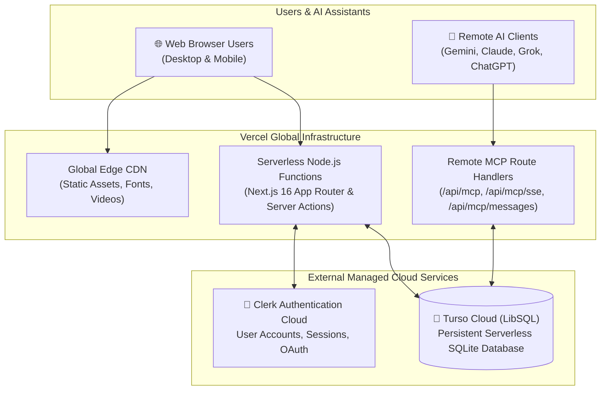

# 🚀 Rooted — Vercel & Production Deployment Guide

This guide details the exact step-by-step production deployment process for **Rooted** using **Vercel** (Compute & Frontend), **Turso** (Serverless LibSQL Database), and **Clerk** (Authentication).

---

## 1. Production Architecture Overview

Rooted is architected as a modern serverless full-stack web application:



---

## 2. Pre-Deployment Verification Checklist

Before triggering a deployment, ensure the following checks pass locally:

1. **TypeScript Type Safety**:
   ```bash
   npx tsc --noEmit
   ```
   *Expected result: 0 errors.*

2. **Production Build Simulation**:
   ```bash
   npm run build
   ```
   *Runs `prisma generate && next build`. Verifies all route segments (`/`, `/tasks`, `/habits`, `/seasons`, `/milestones`, `/growth`, `/notes`, `/settings`, `/api/mcp`) compile successfully.*

3. **Cloud Database Connectivity**:
   - The codebase in `src/lib/prisma.ts` dynamically switches to `@prisma/adapter-libsql` whenever `TURSO_DATABASE_URL` and `TURSO_AUTH_TOKEN` are defined.
   - All 8 database tables (`Goal`, `Milestone`, `Habit`, `HabitLog`, `Task`, `SleepLog`, `SleepSetting`, `Note`, `ApiKey`) exist and are synchronized on the Turso cloud instance.

4. **Repository Cleanliness**:
   - Verify `.env` and `.env.local` are in `.gitignore` (secrets never committed).
   - Verify `/scratch` is in `.gitignore` (prevents binary uploads like `cloudflared.exe`).
   - Clean `.env.example` is committed to the repository for reference.

---

## 3. Required Environment Variables on Vercel

When setting up the project in the **Vercel Dashboard** under **Settings $\rightarrow$ Environment Variables**, configure the following variables:

| Variable Name | Description | Example / Value |
| :--- | :--- | :--- |
| `DATABASE_URL` | Fallback SQLite connection string for Prisma engine build step | `"file:./dev.db"` |
| `TURSO_DATABASE_URL` | Turso LibSQL cloud database endpoint | `libsql://rooted-db-your-name.aws-region.turso.io` |
| `TURSO_AUTH_TOKEN` | Secure authentication JWT issued by Turso CLI or dashboard | `eyJhbGciOi...` |
| `NEXT_PUBLIC_CLERK_PUBLISHABLE_KEY` | Public Clerk key for frontend authentication components | `pk_live_...` or `pk_test_...` |
| `CLERK_SECRET_KEY` | Secret Clerk key for server-side auth verification in middleware | `sk_live_...` or `sk_test_...` |
| `NEXT_PUBLIC_CLERK_SIGN_IN_URL` | Sign-in page route | `/sign-in` |
| `NEXT_PUBLIC_CLERK_SIGN_UP_URL` | Sign-up page route | `/sign-up` |
| `NEXT_PUBLIC_CLERK_AFTER_SIGN_IN_URL`| Destination after sign-in | `/` |
| `NEXT_PUBLIC_CLERK_AFTER_SIGN_UP_URL`| Destination after sign-up | `/` |

---

## 4. Step-by-Step Vercel Deployment Instructions

### Step 1: Push Latest Changes to GitHub
Ensure all code and configurations are committed and pushed to the `main` branch of your GitHub repository:
```bash
git add .
git commit -m "chore: prepare repository for Vercel production deployment"
git push origin main
```

### Step 2: Import Project in Vercel
1. Navigate to [vercel.com](https://vercel.com) and log in with your GitHub account.
2. Click **Add New... $\rightarrow$ Project**.
3. Select your repository: `SamamaKarim092/Personal-Project`.
4. Vercel automatically detects **Next.js**:
   - **Framework Preset**: `Next.js`
   - **Root Directory**: `./`
   - **Build Command**: `prisma generate && next build` (detected from `package.json`)
   - **Output Directory**: `.next` (default)

### Step 3: Configure Environment Variables
Expand the **Environment Variables** section and paste the 9 variables listed in Section 3 above.

### Step 4: Click Deploy
Click **Deploy**. Vercel will:
1. Clone the repository.
2. Install dependencies with `npm install`.
3. Execute `prisma generate && next build`.
4. Deploy the serverless functions and edge static assets across global CDN regions.
5. Provide your live production URL (e.g. `https://rooted-app.vercel.app`).

---

## 5. Post-Deployment Configuration

### 1. Clerk Production Domain Setup
1. In the [Clerk Dashboard](https://dashboard.clerk.com), select your Rooted application.
2. If transitioning from development to production:
   - Navigate to **Domains** and add your Vercel deployment URL (e.g. `https://rooted-app.vercel.app` or your custom domain).
   - Under **Paths**, verify that Sign-in path is `/sign-in` and Sign-up path is `/sign-up`.

### 2. Remote MCP Live Testing (Gemini, Claude, Grok, ChatGPT)
Once deployed on Vercel, Rooted provides a permanent, official HTTPS endpoint for AI assistants:
- **Server Discovery URL**: `https://your-domain.vercel.app/api/mcp`
- **SSE Stream URL**: `https://your-domain.vercel.app/api/mcp/sse?token=rooted_pat_...`
- **Messages URL**: `https://your-domain.vercel.app/api/mcp/messages`

No local tunnels (`cloudflared` or `ngrok`) are required in production! Users simply copy their live URL from the `/settings` page into Google Gemini (Spark) or Claude Desktop.

---

## 6. Related Documentation
- [[03_Architecture_and_Data_Model]] — Relational models and Prisma adapter details.
- [[09_Authentication_and_Multi_Tenancy]] — Clerk user scoping and auto-claim mechanics.
- [[10_AI_Connectors_and_Remote_MCP]] — Remote MCP standard and tool execution.
